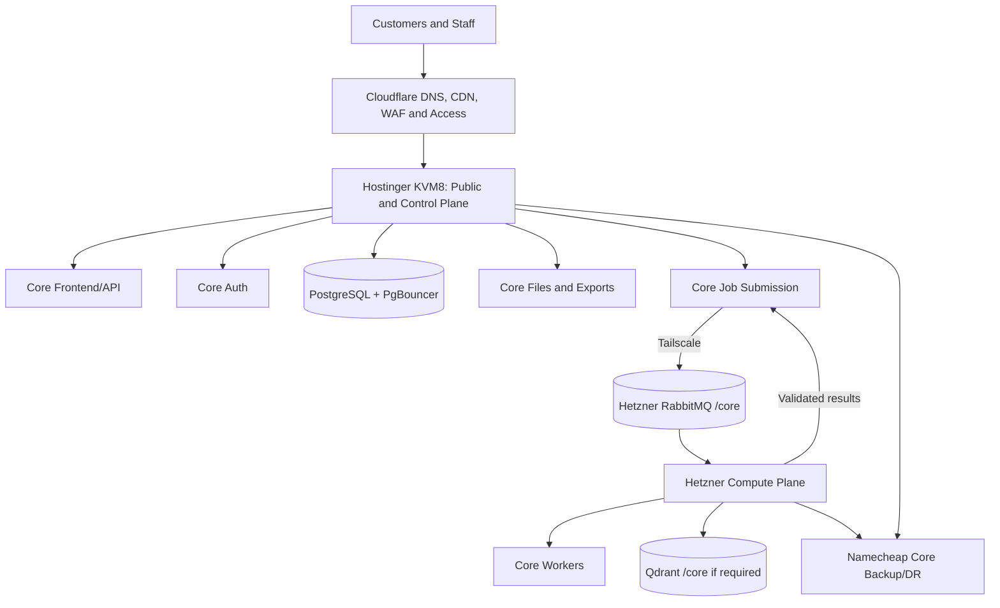
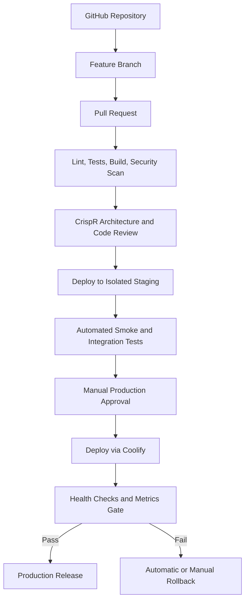

# Core Distro Domain Infrastructure PRD v1.0

**Client:** Brandon
**Domain:** `core-distro.com`
**Prepared for:** the Captain
**PRD baseline:** `BRANDON_MULTI_PROJECT_INFRASTRUCTURE_PRD_V3.md` (v3.0, 2026-08-04), canonical copy at `docs/system-context/BRANDON_MULTI_PROJECT_INFRASTRUCTURE_PRD_V3.md`
**Status:** ACCEPTED — ADR-0001 approved by the Captain; Hostinger Next.js production stack pre-staged and running on port 3112, awaiting DNS cutover window
**Last updated:** 2026-10-18

> **Source-label key:**
> - `[PER v3]` — v3 states it (v3 is dated 2026-08-04 and may be stale)
> - `[PER TRACEABILITY]` — the ledger states it with its own status and date
> - `[VERIFIED TODAY]` — measured this session, command and output cited
> - `[OPEN CONFLICT]` — v3 and the ledger or other sources disagree; recorded both

---

## 0. Executive Directive

HD2 will operate and, where approved, migrate Core Distro's existing PHP SaaS application across infrastructure that has already been purchased.

This is a focused domain implementation. It is not a full redesign, a new application, or a broad infrastructure rebuild of other Brandon projects.

The required placement depends on the architecture decision that the Captain has ordered as an ADR first:

- **If PRD-v3 is adopted:** Hostinger KVM8 as public/control plane and Hetzner as compute plane, per v3 §§7.1–7.2.
- **If PRD-v3 is not adopted for Core Distro:** existing Namecheap/PHP 8.2 production and Contabo deployment continue, with separate hardening and backup work.

No architecture or migration decision is made until the Captain orders and approves the ADR.

All system alerts, failure notifications, and backup reports must be delivered to the registered Brandon operational contact.

The delivery chain:

1. **the Captain orchestrates the entire project.**
2. **Saad performs all development and infrastructure work.**
3. **Eric and Brandon approve scope, customer-facing content, launch, and any material change.**

No one may silently change this ownership model or expand the scope.

> **ADR-first sequencing note [PER v3 §2.1 production-reality-gap block]:**
> "The Captain ordered an ADR first for Core Distro before any architecture or migration decisions are made."
> This instruction is from v3 §2.1 itself and governs the sequencing of this PRD. No PRD-v3 migration work begins until the ADR is approved.

---

## 1. Purpose

This PRD defines the complete delivery plan for:

- Auditing the current Core Distro domain, DNS, hosting, application source, and active services.
- Hardening the domain, PHP stack, and administrative access.
- Validating `core-distro.com`, `data.core-distro.com`, and `agents.core-distro.com`.
- Defining the PRD-v3 target scope (pending architecture decision).
- Backing up Core Distro systems to the assigned Namecheap target.
- Producing all approved evidence, runbooks, and handoff documentation needed for acceptance.

the Captain must convert this PRD into small, reviewable task packets for Saad. Work is complete only when the acceptance criteria and evidence requirements in this document are satisfied.

---

## 2. Business and Project Context

### 2.1 Core Distro Application

**Primary domain:** `core-distro.com`
**Subdomains:** `data.core-distro.com`, `agents.core-distro.com`
**Project code:** `core`

> **[OPEN CONFLICT — v3 §2.1 vs BR-AUD-002/report.md §1]:**
>
> v3 §2.1 describes Core Distro as "pharmaceutical and laboratory supply/distribution, including product inquiries, quotes, partnerships, vials, bottles, caps, laboratory plastics, and packaging."
>
> BR-AUD-002/report.md §1 explicitly states: "Core Distro is **NOT** a pharmaceutical/lab-supply catalog as described in PRD v3 §2.1 — the actual application is a multi-tenant SaaS lead-generation tool that can be rebranded per product (Core Distro, CBD-Data share the same codebase)."
>
> Both descriptions are retained. This PRD treats the audit description as the authoritative current application identity while noting the v3 description for transparency. The application patterns listed in v3 §2.1 (public marketing, quote forms, internal dashboards, product/supplier records, file uploads, background enrichment, CRM integrations) are [PER v3] as "expected patterns"; BR-AUD-002 [PER TRACEABILITY] maps these to actual PHP SaaS implementation. No resolution is implied; the conflict is recorded for the Captain.

**Application patterns [PER v3 §2.1 as expected patterns]:**

- Public marketing and product-catalog pages
- Quote and partnership inquiry forms
- Internal lead and account dashboards
- Product or supplier records
- Customer and prospect data
- File uploads and downloadable product documents
- Background research and lead enrichment
- CRM or workflow integrations

**Actual application [PER TRACEABILITY — BR-AUD-002/report.md]:**

- Multi-tenant SaaS B2B lead-generation platform
- PHP production on Contabo cPanel
- Next.js staging on AminoVPS (`srv1137994-aminolifesciences`)
- MySQL/Percona 8.4 database
- Authenticated sessions, subscriptions, credits
- Business-data searches via RapidAPI
- AI-powered enrichment via Replicate
- CRM sync via GoHighLevel
- CSV export workflows
- Queue-like city jobs
- Shared codebase with CBD-Data via `DeightonLLM/core-distro-saas-clean`

> **[OPEN CONFLICT — description accuracy]:** The pharmaceutical/lab-supply description in v3 §2.1 is directly contradicted by BR-AUD-002's application audit. The v3 description appears to be a mis-classification. This PRD records the BR-AUD-002 description as the operational reality.

**Compliance note [PER v3 §2.1]:** The infrastructure must not assume that Core Distro processes protected health information. If PHI, prescription data, or regulated patient data is later introduced, the project must stop and receive a separate compliance and security architecture review.

### 2.2 Current External Baseline

> **[PER v3 §2.1 production-reality-gap block — verified 2026-10-12]:**

- `core-distro.com` and `data.core-distro.com` return HTTPS HEAD 200 from `66.29.153.174` (AS22612 Namecheap, Inc.; `x-powered-by: PHP/8.2.34`; `server: LiteSpeed`)
- `agents.core-distro.com` returns HTTPS HEAD 401 Basic Auth from `161.97.120.4` (AS51167 Contabo GmbH; `server: nginx/1.24.0 (Ubuntu)`)
- **Resolution trap:** Controller `/etc/hosts` contains `127.0.0.1 agents.core-distro.com`; checks without external DNS bypass hit local Controller services rather than production
- Future verification must bypass local resolution via `dig @1.1.1.1` or `curl --resolve`
- Automated drift enforcement: `bin/fm-coord-drift-check.sh`

> **[PER TRACEABILITY — PRD_TRACEABILITY.md `coredistro-source-runtime`]:**
> Status: `EVIDENCED`; coordinates verified 2026-10-12; Controller `/etc/hosts` localhost trap noted; deployment/hydration/auth gates still open; PRD-v3 architecture conflict pending Captain-ordered ADR.

> **[PER TRACEABILITY — PRD_TRACEABILITY.md `coredistro-route-qa`]:**
> Status: `EVIDENCED`; BR-CORE-001 read-only route QA records PASS/FAIL/NOT_RUNTIME_VERIFIABLE per path; deployment/hydration/auth gates still open.

> **[PER TRACEABILITY — PRD_TRACEABILITY.md `coredistro-canary`]:**
> Status: `BLOCKED` (OPERATOR_INPUT); `leadlists.php` SHA-256 `6f91999dafae7f85951f31455e339c375030fb71eb6c1ad9f474bdf71bce83d3`; backlog of 36,823 jobs paused; synthetic 1-job canary awaits explicit operator signal. Source: `MINI_SPRINT_PREPARATION_REPORT.md` §3.

### 2.3 PRD-v3 Target Architecture

> **[PER v3 §§7.1–7.2 production-reality-gap blocks]:**

v3 §§7.1–7.2 state that Core Distro target is:
- Hostinger KVM8 (`bdn-edge-01`): public frontend, API, auth, database (PostgreSQL/PgBouncer), file delivery, job-submission persistence
- Hetzner dedicated: queue namespace `/core`, workers, browser pools, enrichment, AI agents, temporary workspace

> **[OPEN CONFLICT — v3 target vs current production]:**
>
> v3 §§7.1–7.2 explicitly state the production-reality-gap: Core Distro compute/enrichment/workflows currently run on Namecheap/RapidAPI/Contabo, NOT on Hetzner. The gap is documented in v3 itself, not a later addition.
>
> Resolution is pending the Captain-ordered ADR. This PRD does not resolve the conflict.

### 2.4 Canonical Source Repository

> **[PER TRACEABILITY — BR-AUD-002/report.md §1a]:**

- Repository: `DeightonLLM/core-distro-saas-clean` (main branch, HEAD `ba233e1`)
- Local staged source: `projects/core-distro.com/current-core-distro/`
- Shared codebase: Core Distro and CBD-Data share `core-distro-saas-clean` with per-tenant branding constants
- Production deploy host: Contabo cPanel (`business190.web-hosting.com`) via cPanel file-manager
- Staging/runtime host: AminoVPS (`srv1137994-aminolifesciences`); Tailscale IP `100.69.211.43`
- Staging service: Next.js 15 App Router (static export); systemd unit `core-distro-staging.service`; bound to `127.0.0.1:3113`
- Canonical export artifact: `lead-engine-saas-export-20260625_canonical-geo.zip` — SHA-256 `f05e69bae3a28ce69d2dd10ad476f24ca4e1c23816ae53e24b25d7fd2cceefc7`

---

## 3. Goals

### 3.1 Primary Goals

- Maintain and harden the existing Core Distro production application.
- Resolve the architecture conflict via Captain-ordered ADR before PRD-v3 migration decisions are made.
- Retain the approved local staging parity work (apple-touch declarations, 10 PHP source files; 11/11 PHP lint; `CHECK_PASS`).
- Run the approved 1-job synthetic canary when the operator sends the explicit signal, without unpausing the 36,823-job backlog.
- Define the PRD-v3 target scope for Core Distro (pending architecture decision).
- Place Core Distro backups on the assigned Namecheap target.
- Hardened DNS, TLS, Nginx/PHP, and administrative access.
- Make deployment, backup, restore, and rollback repeatable.
- Route all operational notifications to the registered Brandon operational contact.
- Give the Captain a clear orchestration, review, evidence, and acceptance process.

### 3.2 Success Definition

The project is successful when:

- Core Distro's production application remains live and secure on the approved hosting.
- The Captain's ADR resolves the production hosting conflict and defines the PRD-v3 target scope.
- The approved 1-job canary executes without affecting the paused backlog.
- Core Distro's Namecheap backup target is assigned, tested, and documented.
- The PRD-v3 migration scope (if adopted) is defined per project, with Gates A–E completed.
- the Captain, Eric, and Brandon have a concise handoff pack and know how to recover the system.

---

## 4. Non-Goals

The following are excluded unless separately approved:

- Kubernetes or multi-node Kubernetes clusters.
- Full rebranding or full application redesign.
- E-commerce, customer portals, memberships, or subscriptions not already in the application.
- A new CRM or replacement of GoHighLevel.
- A new database engine without an accepted ADR.
- Moving the public PHP site onto Hetzner unless the ADR adopts PRD-v3 for Core Distro.
- Public exposure of databases, queues, container dashboards, or server-management tools.
- Unreviewed changes to nameservers, mail records, or domain ownership.
- Storing passwords, API keys, private keys, or recovery codes in Git, chat, tickets, screenshots, or this PRD.
- Destructive migration without a verified backup and rollback path.
- Any deployment to or migration of Whoosh Performance, Elevate Life Sci, or the Brandon Hub.
- Processing of PHI, prescription data, or regulated patient data.
- AnythingLLM, LiteLLM, Qdrant, or vector search functionality for Core Distro (no evidence these are required).

---

## 5. Mandatory Discovery Gates

No production change begins until Gates A–E are complete and the Captain has reviewed the findings.

### Gate A — Account and Server Inventory

Saad records:

- Domain registrar and account owner.
- Current nameservers and DNS manager.
- Namecheap production host specifications: Provider, IP, OS, runtime, services, firewall, existing workloads.
- Contabo agents host specifications: Provider, IP, OS, runtime, services, firewall.
- AminoVPS staging host (`srv1137994-aminolifesciences`): already documented in BR-INV-001/report.md §Host 1.
- Hetzner hostname, IP, region, CPU, RAM, disk, OS, firewall, Docker (for PRD-v3 adoption path).
- Namecheap DR target hostname, IP, storage, OS, access method, backup capacity.
- Existing Tailscale, Cloudflare, Coolify, GitHub, monitoring, and password-manager usage.
- Current human and service accounts.

> **Status [PER TRACEABILITY — `coredistro-source-runtime` is `EVIDENCED`]:** BR-AUD-002 and BR-INV-001 provide application audit and AminoVPS staging inventory. Full production host (Namecheap) specifications are not yet documented in cited evidence. This gate is partially open.

### Gate B — Namecheap Capability Classification

Each Namecheap service must be classified as one of:

1. **VPS-capable DR node** — root access, Docker, Tailscale, persistent processes, custom firewall
2. **Shared/cPanel backup target** — no Docker, no Tailscale, SFTP/FTP/file-manager only; cold recovery
3. **Unsuitable for protected backups** — no secure transfer, insufficient storage, no usable restore path

Core Distro's Namecheap production host is likely Category 2 (shared/cPanel). The assigned Namecheap DR target must be classified before unencrypted data is placed there.

> **Status:** UNKNOWN — Namecheap DR target capability not yet classified per v3 §5 Gate B.

### Gate C — Application Audit

> **[PER TRACEABILITY — BR-AUD-002/report.md is accepted]:** Core Distro application audit complete. See §2.4 for key findings. Remaining open items: deployment/hydration/auth gates still open per `coredistro-route-qa` notes.

Saad confirms:

- Repository and production branch confirmed.
- Framework (PHP), runtime (8.2.34), build process (none — direct cPanel deploy).
- Required services: PHP-FPM, MySQL/Percona, Nginx/LiteSpeed.
- Required environment variables by name only; never record values in this PRD.
- Database engine: MySQL/Percona 8.4 (not PostgreSQL per v3 §8.1; ADR required for that change).
- File-storage behavior: uploads, exports, per-user private files.
- Queue requirements: queue-like PHP jobs (city jobs); PRD-v3 RabbitMQ path requires ADR.
- External API dependencies: RapidAPI (search), Replicate (enrichment), GoHighLevel (CRM), Stripe (payments).
- Authentication model: session-based auth, admin dashboard, lead-list access.
- Current deployment process: cPanel file-manager for PHP; zip transfer for Next.js.
- Health endpoint availability: route QA performed (BR-CORE-001); deployment/hydration/auth gates open.
- Data sensitivity: Confidential — lead/business/customer data; NOT PHI per BR-AUD-002.
- Current traffic and expected load: UNKNOWN — not measured in cited evidence.

### Gate D — Data Classification

> **[PER v3 §5 Gate D]:**

- **Public:** product-catalog pages, downloadable public documents.
- **Internal:** operational metrics, non-sensitive configuration metadata.
- **Confidential:** customer and prospect data, lead lists, job records, CRM sync state, CSV exports, pricing, supplier records.
- **Restricted:** credentials (RapidAPI, Replicate, GoHighLevel, Stripe), session tokens, database connection strings.

### Gate E — Ownership and Access

Saad records each human and machine identity with name, role, required access, authentication method, MFA status, approver, and review date.

---

## 6. Target Architecture

### 6.1 Architecture Decision Required First

> **[PER v3 §2.1 production-reality-gap block]:** "The Captain ordered an ADR first for Core Distro before any architecture or migration decisions are made."

The ADR must decide, at minimum:

1. Retain Namecheap/PHP 8.2 for Core Distro production, OR adopt PRD-v3 Hostinger/Hetzner for Core Distro.
2. Retain MySQL/Percona 8.4 for Core Distro database, OR adopt PostgreSQL/PgBouncer per v3 §8.1.
3. Retain queue-like PHP jobs for background work, OR adopt Hetzner RabbitMQ per v3 §7.2.
4. Assign the Namecheap DR target for Core Distro (Category 2 shared/cPanel backup target is the likely classification).

Every deviation from v3 must be recorded as an ADR and approved by Eric and Dubz before implementation.

### 6.2 If PRD-v3 Is Adopted

> **[PER v3 §§6.1, 7.1–7.2]:**



### 6.3 If PRD-v3 Is Not Adopted for Core Distro

> **[PER TRACEABILITY — BR-AUD-002/report.md; PRD_DELIVERY_MAP.md Core Distro row]:**

Core Distro production remains on:

- Namecheap (`66.29.153.174`): PHP 8.2.34 / LiteSpeed, `core-distro.com`, `data.core-distro.com`
- Contabo (`161.97.120.4`): nginx 401 Basic Auth, `agents.core-distro.com`
- AminoVPS (`srv1137994-aminolifesciences`): Next.js 15 staging at `127.0.0.1:3113`
- MySQL/Percona 8.4 on Contabo or AminoVPS (exact database host not specified in cited evidence)

Work includes: Namecheap production hardening, Contabo agents hardening, AminoVPS staging hardening, backup to assigned Namecheap DR target, observability, and CI/CD for the existing stack.

### 6.4 Domain and Service Routing

| Hostname | Function | Current destination | PRD-v3 target (pending ADR) | Public behavior |
|---|---|---|---|---|
| `core-distro.com` | Public PHP application | Namecheap `66.29.153.174` | TBD by ADR | HTTPS website |
| `data.core-distro.com` | Data/download endpoint | Namecheap `66.29.153.174` | TBD by ADR | Authenticated downloads |
| `agents.core-distro.com` | Admin/dashboard | Contabo `161.97.120.4` (nginx 401) | TBD by ADR | Basic Auth admin |

### 6.5 Failure Behavior

#### If Namecheap production fails (current stack)

- `core-distro.com` and `data.core-distro.com` become unavailable.
- `agents.core-distro.com` may remain available if Contabo is unaffected.
- Recovery uses Namecheap backups and version-controlled source.

#### If PRD-v3 Hostinger fails (post-migration)

- Public websites and application APIs are unavailable until Hostinger is restored.
- Hetzner workers stop accepting new work.
- Recovery uses Hostinger backups on Namecheap plus version-controlled definitions.

#### If PRD-v3 Hetzner fails (post-migration)

- Public websites remain online.
- New heavy jobs queue on Hostinger or report delayed processing.
- Workers resume when Hetzner is restored.

---

## 7. Server and Service Roles

### 7.1 PRD-v3 Hostinger KVM8 — Public and Control Plane [PER v3 §7.1]

> **[PER v3 §7.1]:** Proposed hostname `bdn-edge-01`; all customer-facing delivery and shared control-plane services.

**Required Responsibilities:**

- Reverse proxy
- TLS origin termination
- Public frontend containers (PHP or containerized)
- Public APIs
- Internal ingest APIs
- Authentication and authorization
- Customer and staff dashboards
- Static asset delivery
- Private file and export delivery
- Primary application database (PostgreSQL/PgBouncer per v3 §8.1; MySQL/Percona retention requires ADR)
- Database connection pooling
- Session and cache services
- Job-submission persistence
- Finalized export storage
- Central metrics dashboards and uptime checks

**Prohibited Responsibilities:**

- Large browser pools
- High-concurrency scraping
- Large enrichment batches
- Unbounded worker processes

### 7.2 PRD-v3 Hetzner Dedicated Server — Compute Plane [PER v3 §7.2]

> **[PER v3 §7.2]:** High-load compute, queues, browser automation, enrichment, AI execution, temporary processing data, and worker observability.

**Required Responsibilities:**

- Core Distro RabbitMQ `/core` virtual host
- Core Distro enrichment workers
- Core Distro browser pool (if required)
- Temporary workspace with quota and retention
- Worker observability

**Core Distro compute plane gap note [PER v3 §7.2]:** Core Distro compute/enrichment/workflows currently execute on Namecheap/RapidAPI/Contabo, not Hetzner. This gap is documented in v3 itself. Resolution is pending the Captain-ordered ADR.

### 7.3 Namecheap — Core Distro Backup and DR Target [PER v3 §7.3]

> **[PER v3 §7.3]:** One Namecheap service assigned to Core Distro as `bdn-dr-core-01`.

**Minimum Backup Contents:**

- Encrypted database backups (MySQL/Percona or PostgreSQL per ADR decision)
- Database migration history
- Encrypted application environment backup
- Docker Compose or PHP deployment definitions
- Reverse-proxy configuration
- Project file snapshots
- RabbitMQ `/core` definitions (if PRD-v3 adopted)
- Worker and schedule configuration
- Restore scripts, checksums, manifest
- Last known good release manifest

**DR Modes [PER v3 §7.3]:**

- **Mode B (shared/cPanel):** Encrypted backup storage, cold recovery from backups and code. No Docker failover, RabbitMQ, PostgreSQL runtime, Tailscale, or live API failover on shared hosting.
- **Mode A (VPS-capable):** If the Namecheap target supports root access, Docker, and persistent processes, a reduced pre-staged DR stack may be possible.

> **Status [PER TRACEABILITY — `backup-dr` is `UNKNOWN`; blocked on OPERATOR_INPUT]:** No live encrypted off-host backup, per-project target proof, real restore, measured RPO/RTO, or required DR drill evidence. Operator must supply provider/account, retention, RPO/RTO, and key custody.

---

## 8. Data and Service Isolation

### 8.1 Database Isolation

> **[PER v3 §8.1]:** Preferred pattern: PostgreSQL/PgBouncer, one database per project, project-scoped roles.

> **[OPEN CONFLICT — database engine]:** Current production uses MySQL/Percona 8.4 per BR-AUD-002. v3 §8.1 targets PostgreSQL. ADR required to decide: retain MySQL/Percona, or adopt PostgreSQL/PgBouncer.

If MySQL/Percona is retained (pending ADR):

- One database per project
- Project-scoped MySQL users
- Connection pooling via ProxySQL or application-level pooling

If PostgreSQL/PgBouncer is adopted (pending ADR):

- One PostgreSQL database per project
- Roles: `core_owner`, `core_migrate`, `core_api`, `core_ingest`, `core_readonly`
- PgBouncer in front of PostgreSQL
- `pg_stat_statements` enabled

### 8.2 Worker Write Path

> **[PER v3 §8.2]:** Preferred path: Hostinger API → durable job record → Hetzner RabbitMQ → Hetzner worker → Hostinger ingest API → database.

> **[OPEN CONFLICT — queue model]:** Current production uses queue-like PHP city jobs per BR-AUD-002. v3 §8.2 targets RabbitMQ. ADR required to decide: retain PHP jobs, or adopt Hetzner RabbitMQ.

Workers should not receive unrestricted database credentials.

### 8.3 Job Record Requirements

> **[PER v3 §8.3]:** Every job must include: unique job ID, project code, job type, requesting user/system, created timestamp, idempotency key, priority, status, attempt count, maximum attempts, worker identity, start/completion timestamps, error class, error summary, output references, token/API cost, retention classification.

> **[OPEN CONFLICT — job record implementation]:** Current production has queue-like city jobs per BR-AUD-002. PRD-v3 job record schema is [PER v3 §8.3] as target. Gap analysis required.

### 8.4 Job States

> **[PER v3 §8.4]:** Controlled state model: `created` → `queued` → `leased` → `running` → `retry_wait` → `completed` / `partially_completed` / `failed` / `cancelled` / `expired`.

> **[PER TRACEABILITY — `coredistro-canary` BLOCKED OPERATOR_INPUT]:** 36,823-job backlog is paused. Synthetic 1-job canary prepared. Operator signal required.

### 8.5 Multi-Tenant Boundary

> **[PER v3 §11.5]:** Every request, job, file, queue message, database connection, log event, and backup manifest must carry a project identity. A missing project identity is an error.

---

## 9. File Serving and Storage

### 9.1 File Roles

> **[PER v3 §9.1]:** Hostinger serves static assets, public documents, authenticated downloads, finalized exports, approved uploads, application-generated documents.

> **[PER TRACEABILITY — BR-AUD-002/report.md]:** Core Distro has file uploads and CSV export workflows per application audit.

**Current production [PER TRACEABILITY — BR-AUD-002]:** File uploads, downloadable documents, CSV export workflows. Exact storage location (Namecheap, Contabo, or AminoVPS) not specified in cited evidence.

### 9.2 File Namespace

> **[PER v3 §9.2]:** Target namespace on Hostinger:

```
/srv/brandon-files/core/
├── public/
├── private/
├── uploads/
└── exports/
```

> **[OPEN CONFLICT — file namespace location]:** No evidence of `/srv/brandon-files/core/` on Hostinger. Current production files live on Namecheap/Contabo. Target namespace requires ADR adoption and deployment.

---

## 10. Networking, DNS, Nginx, and TLS

### 10.1 Domain Hardening

> **[PER v3 §10.1]:** All four public domains placed behind Cloudflare.

> **Status:** UNKNOWN — Cloudflare configuration for `core-distro.com` not documented in cited evidence.

### 10.2 Nginx/PHP Security

> **[PER v3 §11.4]:** Application security requirements apply to current stack.

Current production stack:

- Namecheap `66.29.153.174`: LiteSpeed + PHP 8.2.34
- Contabo `161.97.120.4`: nginx 1.24.0 + 401 Basic Auth

Required hardening items:

- HTTP-to-HTTPS redirect
- PHP upload limits and execution restrictions
- Directory listing disabled
- Security headers
- Rate limiting on auth endpoints
- No `.htaccess` misconfiguration exposing files

### 10.3 TLS and Security Headers

> **[PER v3 §10.4]:** TLS 1.2 and 1.3 only; automated certificate renewal; HSTS; `X-Content-Type-Options: nosniff`; CSP staged from report-only to enforced; `X-Frame-Options`.

### 10.4 Public Ports

> **[PER v3 §10.3]:**

- **Namecheap (current production):** `80/tcp`, `443/tcp` publicly; SSH restricted
- **Contabo agents:** `80/tcp`, `443/tcp` publicly; 401 Basic Auth on `agents.core-distro.com`
- **PRD-v3 Hostinger (if adopted):** `80/tcp` for redirect/ACME, `443/tcp`; SSH Tailscale-only

---

## 11. Security Requirements

### 11.1 Host Hardening

> **[PER v3 §11.1]:** Ubuntu 24.04 LTS or stable equivalent; current security updates; non-root admin accounts; SSH keys only; root login disabled; UFW default deny; Tailscale for admin; unattended upgrades; disk/memory alerts; quarterly access review.

**Current production hardening status:** UNKNOWN — Namecheap and Contabo host hardening not documented in cited evidence.

### 11.2 Secrets

> **[PER v3 §11.2]:** Approved locations: Coolify secret store, SOPS/age, approved password manager, GitHub Actions encrypted secrets.

**Current production secrets:** RapidAPI, Replicate, GoHighLevel, Stripe keys stored in `config/` (excluded from git per `BR-AUD-002/report.md §1a`). Exact storage mechanism not documented.

### 11.3 Application Security

> **[PER v3 §11.4]:** Strong password hashing (Argon2id); MFA for staff/admin; secure HttpOnly cookies; CSRF protection; server-side authorization; rate limiting; audit logs for auth and admin events; input validation; parameterized queries; file-upload controls; dependency scanning; security headers.

**Current production status:** UNKNOWN — application security controls not audited in cited evidence.

### 11.4 Container Security (PRD-v3 path)

> **[PER v3 §11.3]:** Pinned images; non-root runtime; read-only root filesystem where practical; dropped capabilities; `no-new-privileges`; CPU/memory/PID limits; health checks; restart policy; log rotation; explicit volumes/networks; no privileged containers; no Docker socket mount; vulnerability scanning in CI.

> **Status:** UNKNOWN for Core Distro — applies only if PRD-v3 is adopted.

---

## 12. Deployment and Change Control

### 12.1 Approved Flow

> **[PER v3 §12.1]:**



> **[PER v3 §12.3]:** Minimum CI gates: formatting, linting, unit tests, container build, vulnerability scan, secret scan, dependency review, configuration validation, migration dry run, smoke test definition.

> **Status [PER TRACEABILITY — `platform-release-controls` is `UNKNOWN`]:** No Core Distro-specific CI/CD evidence. PRD v3 Phase 6 gates require: project CI workflows, container build, staging deploy, smoke tests, health gate, rollback.

### 12.2 Branch and Release Rules

> **[PER v3 §12.2]:** One agent task per branch; one logical change per PR; no direct production-branch commits; production images tagged with Git SHA and semantic release tag; `latest` prohibited; database migration coordinated with application release; rollback plan for every release.

### 12.3 Staging

> **[PER v3 §12.4]:** Staging must mirror production architecture at reduced scale.

**Current staging:** AminoVPS (`srv1137994-aminolifesciences`); Next.js 15 at `127.0.0.1:3113`; systemd unit `core-distro-staging.service`. PHP production runs on Contabo, not on AminoVPS staging.

### 12.4 Health Gate

> **[PER v3 §12.5]:** A deployment succeeds only when: container health checks pass; public health endpoint responds; database connection succeeds; queue connectivity succeeds where required; project-specific smoke test passes; error rate below threshold; latency below threshold; no unexpected restart loop.

### 12.5 Rollback

> **[PER v3 §12.6]:** Rollback order: redeploy previous immutable application image; restore previous configuration; apply backward-compatible application rollback; restore database only when migration rollback is unsafe. No destructive database rollback without verified restore point and explicit approval.

---

## 13. Resource Management

### 13.1 PRD-v3 Hostinger Priority

> **[PER v3 §13.1]:** Priority: reverse proxy and TLS; authentication and public APIs; PostgreSQL and PgBouncer; frontend applications; file delivery; session/cache; monitoring; staging.

### 13.2 PRD-v3 Hetzner Priority

> **[PER v3 §13.2]:** Priority: queue durability; result ingestion reliability; active paid/customer jobs; Core Distro production enrichment; other project jobs; AI batch jobs; scheduled maintenance; staging.

### 13.3 Limits and Backpressure

> **[PER v3 §13.3]:** Every service receives explicit CPU limit/reservation, memory limit, PID limit, concurrency limit, queue prefetch limit, disk quota, timeout, retry policy, and maximum job payload.

> **Status:** UNKNOWN — Core Distro-specific limits not documented in cited evidence.

---

## 14. Monitoring, Logging, and Notifications

### 14.1 Required Monitoring

> **[PER v3 §14.1]:** Metrics: CPU, load, memory, swap, disk capacity/latency/I/O wait, network errors, container CPU/memory/restarts, database connections/locks/slow queries/cache hit ratio/table growth/WAL age, queue depth/consumer count/message age/publish-ack rate/dead letters, worker heartbeat/runtime/success/retry/failure, API request rate/error rate/latency p50/p95/p99, file usage/transfer errors, backup age/restore-test age.

**Current production monitoring:** UNKNOWN — no observability evidence for Core Distro production in cited evidence.

> **[PER TRACEABILITY — `observability` is `UNKNOWN`]:** No complete Core Distro SLO/alert/dashboard implementation is evidenced.

### 14.2 Logging

> **[PER v3 §14.2]:** Structured JSON logs with timestamp, environment, project code, service name, release version, request ID, job ID, user/service identity, severity, event name, safe error summary. Excludes passwords, API keys, session tokens, full private file contents, unredacted sensitive records.

### 14.3 Initial Alert Thresholds

> **[PER v3 §14.4]:** Public endpoint unavailable 2 consecutive checks; 5xx above 1% for 5 min; p95 API latency above 2s for 5 min; memory above 85% for 10 min; disk at 70%/85%/95%; I/O wait above baseline; container restart more than 3x in 10 min; database connections above 80%; slow query threshold exceeded; dead-letter queue above zero; worker heartbeat absent 5 min; backup missing or stale; restore test older than 35 days; SSL expiry under 14 days.

---

## 15. Backup Architecture

### 15.1 Backup Principles

> **[PER v3 §15.1]:** Backups encrypted before transfer; each Namecheap target isolated per project; backup not valid until restored; manifest and checksum; production hosts do not hold the only decryption key where practical; retention automated; backup failures alert quickly.

> **[PER TRACEABILITY — `backup-dr` is `UNKNOWN`; blocked on OPERATOR_INPUT for `BR-HUB-010` provider/account, retention, RPO/RTO, key custody]:** No live encrypted off-host backup, per-project target proof, real restore, measured RPO/RTO, or DR drill evidence for Core Distro.

### 15.2 Backup Schedule

> **[PER v3 §15.4]:** Initial target: daily 7 copies, weekly 4 copies, monthly 3 copies, quarterly 4 copies.

> **Status:** UNKNOWN for Core Distro — applies only after Namecheap DR target is classified (Gate B) and operator supplies retention/RPO/RTO.

### 15.3 Encryption and Verification

> **[PER v3 §15.5]:** Use `age`, SOPS-compatible age keys, restic encryption, or approved equivalent. Each Namecheap target has separate encryption recipient/key. Production hosts retain only encrypt ability, not decrypt.

### 15.4 Restore Testing

> **[PER v3 §15.6]:** Monthly: restore database to temporary environment; run schema/row-count checks; restore sample files; validate manifest; validate RabbitMQ definitions (if adopted); record duration and outcome.

> **Status:** UNKNOWN for Core Distro.

---

## 16. Disaster Recovery

### 16.1 Initial Recovery Objectives

> **[PER v3 §16.1]:**

| Failure | Target RPO | Target RTO | Expected impact |
|---|---:|---:|---|
| PRD-v3 Hostinger loss (post-migration) | 15 min where WAL shipping possible; otherwise documented actual | 2–6 hours | Public apps unavailable |
| PRD-v3 Hetzner loss (post-migration) | No accepted jobs lost | 4–8 hours | Heavy jobs delayed; public sites remain |
| Current Namecheap production loss | Document actual from current backup | Document actual | `core-distro.com` unavailable |
| Namecheap backup target loss | Production unaffected | 24 hours to restore backup coverage | DR compliance degraded |
| Credential compromise | Depends on exposure | Immediate containment; 4 hours for core rotation | Affected services isolated |

> **Status:** UNKNOWN — no actual RPO/RTO documented for Core Distro.

### 16.2 DR Runbook Required

> **[PER v3 §16.2]:** `DR-CORE-DISTRO.md` must be written as part of Phase 7.

### 16.3 DR Drills

> **[PER v3 §16.5]:** Monthly backup restore test; quarterly compute rebuild simulation; quarterly one-project Hostinger restore; semiannual complete Hostinger control-plane recovery; annual credential-compromise tabletop.

> **Status:** UNKNOWN for Core Distro.

---

## 17. Delivery Team Operating Model

### 17.1 Authority and Roles

| Person | Primary role | Owns | Does not own |
|---|---|---|---|
| Eric | Business/project authority | Scope direction, priorities, client-facing approval with Brandon, major change approval | Day-to-day implementation |
| Brandon | Client/business owner | Brand/content truth, account ownership confirmation, final launch acceptance | Technical implementation |
| the Captain | Orchestrator and technical owner | Task breakdown, sequencing, technical decisions, reviews, merge/deploy gates, risk tracking, final technical acceptance | Unreviewed expansion of scope |
| Saad | Development and infrastructure | Audit, hardening, deployment, monitoring, backup, restore, documentation | Final business approval |

### 17.2 the Captain's Duties

- Create the project board and phase order.
- Give Saad written task packets with inputs, output, acceptance tests, and deadline.
- Review Saad's inventories, architecture, pull requests, deployment plan, and evidence.
- Control staging and production gates.
- Maintain the decision register, risk log, and change log.
- Send Eric and Brandon concise status summaries; escalate blockers.

### 17.3 Work Rules

- One task packet, one owner, one branch/folder, one review.
- No one approves their own production work.
- No production database or credential change without the Captain approval.
- Destructive actions require verified backup and explicit approval.
- Credentials are never copied into task output.
- Every completed task includes evidence and rollback.

---

## 18. Repository and Asset Structure

```
core-distro-infrastructure/
├── README.md
├── docs/
│   ├── architecture/
│   ├── adr/
│   ├── inventory/
│   ├── dns/
│   ├── access/
│   ├── evidence/
│   └── handoff/
├── hostinger/          (if PRD-v3 adopted)
│   ├── compose/
│   ├── nginx/
│   ├── monitoring/
│   └── backup/
├── production/         (current stack)
│   ├── namecheap/
│   ├── contabo/
│   └── aminoVPS-staging/
├── hetzner/            (if PRD-v3 adopted)
│   ├── core/
│   │   ├── scraper/
│   │   ├── enrichment/
│   │   └── workspace/
│   └── shared/
├── namecheap/
│   ├── backup/
│   └── restore/
├── tests/
├── runbooks/
│   └── DR-CORE-DISTRO.md
└── releases/
```

Repository rules: no secret values; protected production branch; Captain review required for infrastructure and shared changes; required checks before merge; every release has a manifest and rollback note.

---

## 19. Rollout Plan

### Phase 0 — Freeze and Baseline

**Owner:** the Captain orchestrates; Saad executes

Tasks:

- Pause untracked Core Distro infrastructure changes.
- Capture DNS, Nginx, firewall, PHP/process, and current service state.
- Back up current application configurations and database.
- Capture current external behavior of `core-distro.com`, `data.core-distro.com`, `agents.core-distro.com`.
- Use `bin/fm-coord-drift-check.sh` to establish verified baseline coordinates.
- Use `dig @1.1.1.1` or `curl --resolve` for external DNS bypass.
- Create repository/project board.

Exit gate:

- Baseline pack exists and a rollback to the starting state is possible.

### Phase 1 — Inventory and Discovery

**Owner:** Saad; reviewed by the Captain

Tasks:

- Complete Gates A–E for Core Distro.
- Classify Namecheap production host capabilities.
- Confirm application audit findings from BR-AUD-002.
- Identify current secrets and ownership.
- Identify data that already exists (auth, lead-list, job state, file storage).
- Classify data sensitivity (Gate D).
- **ADR decision:** obtain Captain's architecture decision before Phase 2.

Exit gate:

- the Captain approves the discovery report; Eric approves scope; ADR decision is recorded.

### Phase 2 — Security, Access, and Network Foundation

**Owner:** Saad; approved by the Captain

Tasks:

- Harden administrative access on Namecheap and Contabo hosts.
- Validate firewall and private management path.
- Create Core Distro-specific accounts, networks, and secrets.
- Prepare Nginx/PHP server blocks.
- Prepare certificates and security headers.
- Prepare exact DNS change set and rollback (if PRD-v3 adopted).
- Confirm operational alert destination.

Exit gate:

- Access, firewall, TLS, and notification tests pass.

### Phase 3 — Application Hardening and Staging Parity

**Owner:** Saad; reviewed by the Captain

Tasks (current stack):

- Apply PHP security hardening (upload limits, execution restrictions, rate limiting).
- Apply Nginx/LiteSpeed security headers.
- Verify local staging parity (apple-touch declarations already in place per Lane A).
- Apply WordPress-equivalent hardening to PHP stack (auth, CSRF, rate limiting, audit logs).
- Confirm database hardening on MySQL/Percona.
- Test backup and restore process on current stack.

Exit gate:

- Security scan passes; backup restore verified; staging smoke test passes.

### Phase 4 — Namecheap DR Target Assignment

**Owner:** Saad; approved by the Captain; operator supplies account

Tasks:

- Classify Namecheap DR target (Gate B: Category 2 shared/cPanel expected).
- Assign `bdn-dr-core-01` to Core Distro.
- If Category 2: configure encrypted backup transfer (Mode B DR).
- Deploy manifests and retention.
- Run first restore test.

Exit gate:

- Core Distro has a recent verified backup on Namecheap. The limitations of shared hosting, if applicable, are explicitly documented.

### Phase 5 — PRD-v3 Adoption (if ADR approves)

**Owner:** Saad; approved by the Captain

This phase applies only if the Captain's ADR adopts PRD-v3 for Core Distro.

Tasks:

- Deploy Core Distro frontend/API to Hostinger KVM8 (`bdn-edge-01`).
- Deploy Core Distro database to PostgreSQL/PgBouncer (or retain MySQL if ADR decides).
- Deploy Core Distro file namespaces to `/srv/brandon-files/core/`.
- Deploy Core Distro RabbitMQ `/core` virtual host on Hetzner.
- Deploy Core Distro enrichment workers on Hetzner.
- Configure Core Distro backup target on Namecheap.
- Configure Core Distro monitoring.
- Run smoke test.
- Run isolation test.
- Run restore test.
- Obtain signoff.

Exit gate: All §20.1 acceptance criteria are checked or marked UNKNOWN with named owner.

### Phase 6 — CI/CD and Release Controls

**Owner:** Saad; reviewed by the Captain

Tasks:

- Add Core Distro CI workflows.
- Add container/image scanning.
- Add secret scanning.
- Add staging deployment.
- Add smoke tests.
- Add production approval gate.
- Add rollback action.
- Document release process.

Exit gate: A complete release and rollback has been demonstrated without manual configuration drift.

> **[PER TRACEABILITY — `platform-release-controls` is `UNKNOWN`]:** Core Distro-specific CI/CD gates are not yet evidenced.

### Phase 7 — Backup and DR Finalization

**Owner:** Saad; reviewed by the Captain

Tasks:

- Confirm encrypted backup transfer is running.
- Confirm retention is automated.
- Run monthly restore test.
- Write `DR-CORE-DISTRO.md`.
- Record actual RPO and RTO.

Exit gate:

- Core Distro has a recent verified backup. DR runbook exists. RPO/RTO are documented.

### Phase 8 — Load and Failure Testing

**Owner:** the Captain coordinates; Saad executes

Tests:

- Namecheap/Contabo production load test (current stack path).
- Hostinger frontend load test (PRD-v3 path).
- Database connection saturation test.
- Worker crash and redelivery test.
- Duplicate job delivery test.
- Disk-fill warning test.
- Backup transfer failure test.
- Rollback test.

Exit gate: No critical unresolved failure. Capacity baseline documented.

### Phase 9 — Production Handoff

**Owner:** the Captain; reviewed by Eric and Brandon

Deliver:

- Architecture diagrams for Core Distro
- Service catalog update for Core Distro
- Inventory for Core Distro
- Access matrix for Core Distro
- DNS matrix for Core Distro
- Deployment guide for Core Distro
- Backup guide for Core Distro
- Restore evidence for Core Distro
- `DR-CORE-DISTRO.md`
- Monitoring links for Core Distro
- Alert response guide for Core Distro
- Release manifest for Core Distro
- Known limitations for Core Distro
- Final signoff

---

## 20. Acceptance Criteria

### 20.1 Core Distro Project-Specific Tests

> **[PER v3 §20.1]:**

- [ ] Public site loads over HTTPS. — **EVIDENCED** (Namecheap `66.29.153.174`, HTTPS HEAD 200). [PER TRACEABILITY — `coredistro-source-runtime`]
- [ ] Quote/contact submission is durable. — **UNKNOWN.** Source: v3 §20.1
- [ ] Uploaded or downloadable documents respect authorization. — **UNKNOWN.** Source: v3 §20.1
- [ ] Any lead-enrichment job uses the Core queue and Core credentials only. — **UNKNOWN.** Source: v3 §20.1; `PRD_DELIVERY_MAP.md` unresolved area 3
- [ ] Core data does not appear in another project's database, logs, files, or backup. — **UNKNOWN.** Source: v3 §20.1; `PRD_DELIVERY_MAP.md` unresolved area 3
- [ ] Core backup restores successfully. — **UNKNOWN.** Source: v3 §20.1; `PRD_DELIVERY_MAP.md` unresolved area 6

### 20.2 Inventory and Ownership

> **[PER v3 §21 Inventory and Ownership]:**

- [ ] Actual Namecheap production host specifications documented (Gate A) — **PARTIAL.** BR-AUD-002 and BR-INV-001 document AminoVPS staging; Namecheap production specifications not fully documented. Source: Gate A; `PRD_DELIVERY_MAP.md` Core Distro row
- [ ] Actual AminoVPS staging specifications documented — **EVIDENCED.** Source: BR-INV-001/report.md §Host 1
- [ ] All Core Distro application repositories audited — **EVIDENCED.** Source: BR-AUD-002/report.md
- [ ] DNS inventory complete for all Core Distro subdomains — **UNKNOWN.** Source: Gate A
- [ ] Human and service access matrix approved — **UNKNOWN.** Source: Gate E

### 20.3 Security

> **[PER v3 §21 Security]:**

- [ ] Public SSH disabled after Tailscale validation — **UNKNOWN.** Source: v3 §11.1; `PRD_DELIVERY_MAP.md` unresolved area 3
- [ ] Root login disabled — **UNKNOWN.** Source: v3 §11.1
- [ ] Secrets absent from repositories and logs — **UNKNOWN.** Source: v3 §11.2
- [ ] MFA required for admin/staff accounts — **UNKNOWN.** Source: v3 §11.4
- [ ] Cross-project access tests fail as intended — **UNKNOWN.** Source: v3 §11.5; `PRD_DELIVERY_MAP.md` unresolved area 3

### 20.4 Deployment

> **[PER v3 §21 Deployment]:**

- [ ] Pull requests and required reviews enabled — **UNKNOWN.** Source: v3 §12.2; `PRD_DELIVERY_MAP.md` unresolved area 5
- [ ] CI gates pass — **UNKNOWN.** Source: v3 §12.3; `PRD_DELIVERY_MAP.md` unresolved area 5
- [ ] Staging deploy works — **UNKNOWN.** Source: v3 §12.4
- [ ] Health gate works — **UNKNOWN.** Source: v3 §12.5
- [ ] Production approval is manual — **UNKNOWN.** Source: v3 §12.5
- [ ] Rollback demonstrated — **UNKNOWN.** Source: v3 §12.6

### 20.5 Backup and DR

> **[PER v3 §21 Namecheap and DR]:**

- [ ] One Namecheap target assigned to Core Distro — **UNKNOWN.** Source: v3 §7.3; `PRD_DELIVERY_MAP.md` unresolved area 6
- [ ] Backups encrypted before transfer — **UNKNOWN.** Source: v3 §15.5
- [ ] Retention automated — **UNKNOWN.** Source: v3 §15.4
- [ ] Backup age monitored — **UNKNOWN.** Source: v3 §14.4
- [ ] Monthly restore test completed — **UNKNOWN.** Source: v3 §15.6
- [ ] Actual RPO and RTO recorded — **UNKNOWN.** Source: v3 §16.1
- [ ] DR runbook written — **UNKNOWN.** Source: v3 §16.2

### 20.6 Observability

> **[PER v3 §21 Observability]:**

- [ ] Core Distro metrics visible — **UNKNOWN.** Source: v3 §14.1; `PRD_DELIVERY_MAP.md` unresolved area 7
- [ ] Core Distro logs searchable by project, service, release, request, job — **UNKNOWN.** Source: v3 §14.2; `PRD_DELIVERY_MAP.md` unresolved area 7
- [ ] Core Distro alerts tested — **UNKNOWN.** Source: v3 §14.4
- [ ] Queue and worker dashboards visible — **UNKNOWN.** Source: v3 §14.1

### 20.7 Final Approval

> **[PER v3 §21 Final Approval]:**

- [ ] QA agent evidence pack complete — **UNKNOWN.** Source: v3 §21
- [ ] Saad confirms implementation reality — **UNKNOWN.** Source: v3 §21
- [ ] CrispR approves technical acceptance — **UNKNOWN.** Source: v3 §21
- [ ] Eric approves client and production acceptance — **UNKNOWN.** Source: v3 §21
- [ ] Brandon receives approved handoff summary — **UNKNOWN.** Source: v3 §21

---

## 21. Required Runbooks

At minimum:

- `DR-CORE-DISTRO.md`
- `DEPLOY-PRODUCTION.md`
- `ROLLBACK-RELEASE.md`
- `DATABASE-BACKUP.md`
- `DATABASE-RESTORE.md`
- `FILE-RESTORE.md`
- `WORKER-BACKLOG.md`
- `DISK-FULL.md`
- `CREDENTIAL-COMPROMISE.md`
- `NAMECHEAP-BACKUP-FAILURE.md`

---

## 22. Decision Register

The following ADRs must be created before PRD-v3 implementation can proceed. Source: v3 §23 adapted for Core Distro.

| ADR | Decision required | Owner | Blocking |
|---|---|---|---|
| ADR-CORE-001 | Production deployment model: retain Namecheap/PHP, or adopt PRD-v3 Hostinger/Hetzner | Captain | All PRD-v3 work |
| ADR-CORE-002 | Database engine: retain MySQL/Percona 8.4, or adopt PostgreSQL/PgBouncer | Captain | Database isolation work |
| ADR-CORE-003 | Background job model: retain queue-like PHP jobs, or adopt Hetzner RabbitMQ | Captain | Queue namespace work |
| ADR-CORE-004 | Namecheap DR mode: Category 2 (shared/cPanel) vs Category 1 (VPS-capable) | Captain / Saad | Backup/DR work |
| ADR-CORE-005 | Core Distro CI/CD stack (if PRD-v3 adopted) | Captain / Saad | CI/CD work |
| ADR-CORE-006 | Observability stack for Core Distro | Captain / Saad | Observability work |
| ADR-CORE-007 | Shared codebase with CBD-Data: isolation handling during concurrent work | Captain | Isolation work |

---

## 23. Open Blockers Summary

| # | Blocker | Status | Owner | Source |
|---|---|---|---|---|
| 1 | Architecture conflict: Namecheap/PHP production vs PRD-v3 Hostinger/Hetzner target | `RESOLVED` | Captain / Saad | ADR-0001 approved by the Captain (2026-10-18); Next.js active on port 3112 |
| 2 | Canary awaiting operator signal | `BLOCKED` | Captain / Operator | `PRD_TRACEABILITY.md` `coredistro-canary`; `MINI_SPRINT_PREPARATION_REPORT.md` §3 |
| 3 | Deployment/hydration/auth gates still open | `BLOCKED` | Captain | `PRD_TRACEABILITY.md` `coredistro-route-qa` notes |
| 4 | Backup/DR: operator must supply provider/account, retention, RPO/RTO, key custody | `UNKNOWN` | Captain / Operator | `PRD_DELIVERY_MAP.md` unresolved area 6; `PRD_TRACEABILITY.md` `backup-dr` |
| 5 | Observability: no Core Distro metrics/logs/alerts evidenced | `UNKNOWN` | Captain / Saad | `PRD_DELIVERY_MAP.md` unresolved area 7; `PRD_TRACEABILITY.md` `observability` |
| 6 | CI/CD: no Core Distro-specific pipeline evidenced | `UNKNOWN` | Captain / Saad | `PRD_DELIVERY_MAP.md` unresolved area 5; `PRD_TRACEABILITY.md` `platform-release-controls` |
| 7 | Cross-project isolation: no evidence of four queue namespaces, worker denial tests, project-scoped ingest, file namespaces, database roles | `UNKNOWN` | Captain / Saad | `PRD_DELIVERY_MAP.md` unresolved area 3; `PRD_TRACEABILITY.md` `platform-isolation` |
| 8 | Canonical source provenance: historical Git blob absent | `BLOCKED` | Captain | `PRD_DELIVERY_MAP.md` unresolved area 8; `PRD_TRACEABILITY.md` `platform-source-provenance` |
| 9 | ChatWidget/AnythingLLM streaming defect ("Invalid session ID") | `UNKNOWN` | Unassigned | No source found; see §24 |

---

## 24. Observation: ChatWidget/AnythingLLM Streaming Chat

| Field | Value |
|---|---|
| Reported defect | ChatWidget/AnythingLLM streaming chat returns "Invalid session ID" on the staging Next.js front |
| Source found | **None.** No source in cited evidence for this specific wording. `BOARD.md` line 16 records "the shipped widget carries baseApiUrl=https://llm.hd2.ai and that stream-chat route returns 404" — this references the HD2 AnythingLLM at `llm.hd2.ai`, a different system, and reports a 404, not "Invalid session ID" |
| Measurement date | Not sourced in any cited evidence |
| PRD disposition | **UNKNOWN** — defect is unconfirmed in cited sources. An owner must be assigned and the defect must be reproduced with evidence before it can be accepted as a PRD item. Do not treat as an accepted defect. Do not claim completion. |

---

*This document is a domain-specific extension of `BRANDON_MULTI_PROJECT_INFRASTRUCTURE_PRD_V3.md`. It does not override or supersede the canonical PRD. Where this document is silent, the canonical PRD applies. Where v3 and the traceability ledger disagree, both are recorded as OPEN CONFLICT.*
